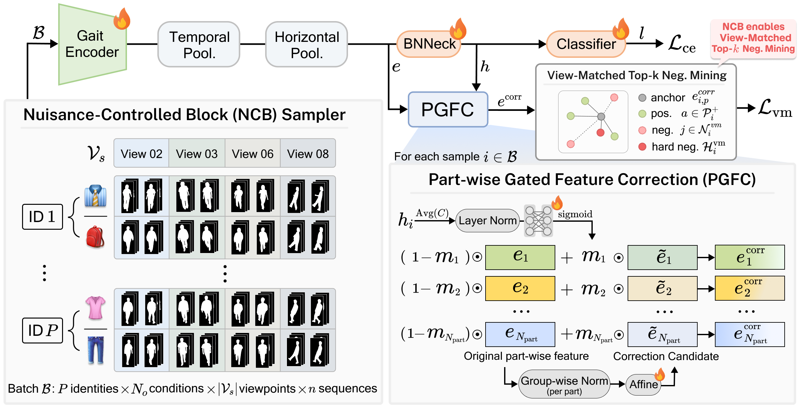

# 🚶 Nuisance-Controlled Learning for Robust Cloth-Changing Gait Recognition (WACV2027)

<!-- <a href="PROJECT_PAGE_URL"> -->
<a href="https://ncgait.github.io/">
  
</a>
<!-- TODO: add Project Page / arXiv badges
<a href="https://arxiv.org/abs/ARXIV_ID">
  
</a>
-->

<br>
This repository contains official code implementation of "Nuisance-Controlled Learning for Robust Cloth-Changing Gait Recognition". We provide PyTorch training and evaluation code and the configurations reported in the paper for CCPG, SUSTech1K, and CASIA-B.


# Abstract
Silhouette-based gait recognition is attractive for long-distance person identification because it suppresses RGB appearance shortcuts such as color, texture, and background. However, silhouettes remain sensitive to nuisance factors such as clothing and viewpoint changes, while standard identity-balanced PK sampling does not explicitly control these nuisance relations within a mini-batch. As a result, same-identity positives and different-identity negatives can provide nuisance-entangled metric supervision. To address this issue, we propose a nuisance-controlled learning framework for robust cloth-changing gait recognition. Our method combines a Nuisance-Controlled Block (NCB) Sampler that constructs shared-viewpoint nuisance-condition blocks, Part-wise Gated Feature Correction (PGFC) that selectively corrects nuisance-sensitive part-wise embeddings, and View-Matched Top-k Negative Mining that selects hard negatives under matched viewpoints in the corrected metric space. On CCPG, our method improves DeepGaitV2 from 83.0% to 86.8% under the gait protocol and from 93.9% to 95.6% under the ReID protocol, together with consistent gains in mAP and mINP. Additional experiments on CASIA-B\* and SUSTech1K show consistent improvements across datasets, while robustness analyses indicate that the nuisance relations required during training can also be approximated when manual nuisance annotations are incomplete or unavailable.

<p align="center">
     <br />
    <em>
    </em>
</p>


# Getting started

Our implementation is based on [OpenGait](https://github.com/ShiqiYu/OpenGait). We provide configs for four backbones: DeepGaitV2, GaitBase, GaitPart, and GaitSet.

## 1) Clone the repository

```bash
git clone https://github.com/egene-chung/NCGait.git
cd NCGait
```

## 2) Download datasets ([CCPG](datasets/CCPG/README.md), [SUSTech1K](datasets/SUSTech1K/README.md), [CASIA-B](datasets/CASIA-B/README.md)) then set `data_root` in `env.yaml`.

```yaml
data_root: {DATA_ROOT}
output_root: {OUTPUT_ROOT}
```
{DATA_ROOT} is the folder that holds all processed datasets, and {OUTPUT_ROOT} is where checkpoints and logs are written (`./output` if left empty). Every config resolves its dataset path from `data_root`, so no config needs to be edited. Place the datasets as follows:

```
{DATA_ROOT}/
|-- CCPG/CCPG-end2end-pkl-refined/
|-- SUSTech1K/SUSTech1K-Released-pkl/
`-- CASIA-B/casiab-128-end2end/
```

If you start from the original CCPG silhouette and RGB folders, generate the pickle format with:

```bash
python datasets/CCPG/organize_ccpg.py \
  --sil_path /path/to/CCPG_G_SIL \
  --rgb_path /path/to/CCPG_D_MASK_FACE_SHOE \
  --output_path {DATA_ROOT}/CCPG/CCPG-end2end-pkl-refined
```

## 3) Environment setup
```bash
conda env create -f environment.yml
conda activate gait
```

## 4) Train
`$CONFIG` can be any of the following configs:

| Dataset    | DeepGaitV2                                                | GaitBase                                                | GaitPart                                           | GaitSet                                                |
| ---------- | --------------------------------------------------------- | ------------------------------------------------------- | -------------------------------------------------- | ------------------------------------------------------ |
| CCPG       | `configs/ccpg/deepgaitv2_ccpg-ncb-pgfc-vm.yaml`           | `configs/ccpg/gaitbase_ccpg-ncb-pgfc-vm.yaml`           | `configs/ccpg/gaitpart_ccpg-ncb-vm.yaml`           | `configs/ccpg/gaitset_ccpg-ncb-pgfc-vm.yaml`           |
| SUSTech1K  | `configs/sustech1k/deepgaitv2_sustech1k-ncb-pgfc-vm.yaml` | `configs/sustech1k/gaitbase_sustech1k-ncb-pgfc-vm.yaml` | `configs/sustech1k/gaitpart_sustech1k-ncb-vm.yaml` | `configs/sustech1k/gaitset_sustech1k-ncb-pgfc-vm.yaml` |
| CASIA-B    | `configs/casiab/deepgaitv2_casiab-ncb-pgfc-vm.yaml`       | `configs/casiab/gaitbase_casiab-ncb-pgfc-vm.yaml`       | `configs/casiab/gaitpart_casiab-ncb-vm.yaml`       | `configs/casiab/gaitset_casiab-ncb-pgfc-vm.yaml`       |
| Iterations | 70k                                                       | 70k                                                     | 120k                                               | 70k                                                    |

An example command line for the train (two GPUs):
```bash
CUDA_VISIBLE_DEVICES=0,1 torchrun --nproc_per_node=2 \
  opengait/main.py \
  --cfgs $CONFIG \
  --phase train \
  --log_to_file
```
`run.sh` runs train and eval for `configs/ccpg/deepgaitv2_ccpg-ncb-pgfc-vm.yaml` in one go. Checkpoints and logs are written to `${output_root}/${dataset_name}/${model_name}/${save_name}`.

## 5) Eval
The evaluator batch size is set to 2, so run evaluation on two GPUs. Each config evaluates its final checkpoint by default; add `--iter $ITER` to evaluate a different iteration.
An example command line for the test:
```bash
CUDA_VISIBLE_DEVICES=0,1 torchrun --nproc_per_node=2 \
  opengait/main.py \
  --cfgs $CONFIG \
  --phase test \
  --log_to_file
```


# Citations
If you find our work interesting, please consider citing
```
@inproceedings{chung2027nuisance,
  title = {Nuisance-Controlled Learning for Robust Cloth-Changing Gait Recognition},
  author = {Chung, Egene and Kim, Jeongin and Song, Mingyeong and Sung, Jaeyi and Jung, Eunji and Lee, Taeyong and Noh, Junhyug},
  booktitle = {Winter Conference on Applications of Computer Vision (WACV)},
  year = {2027}
}
```
